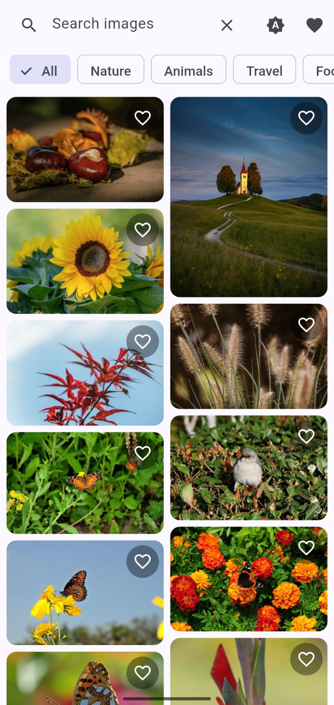
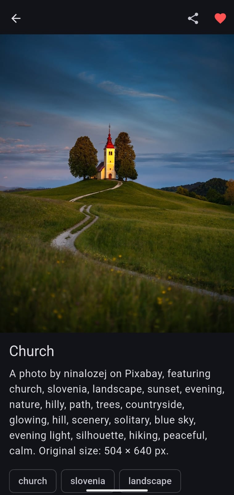
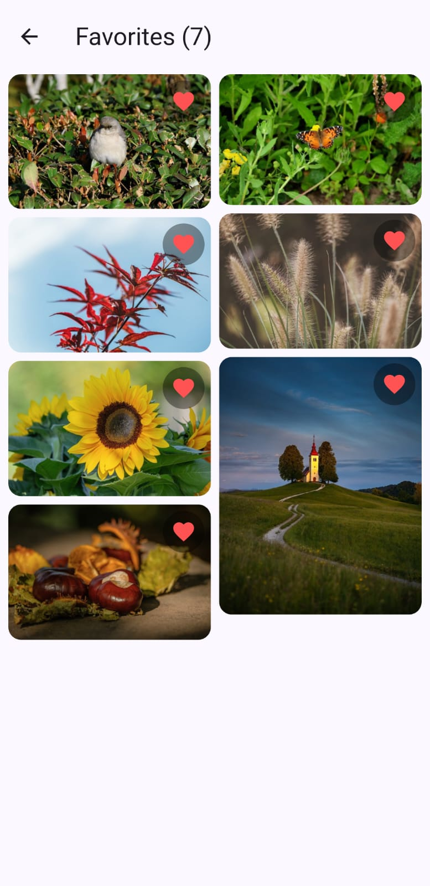
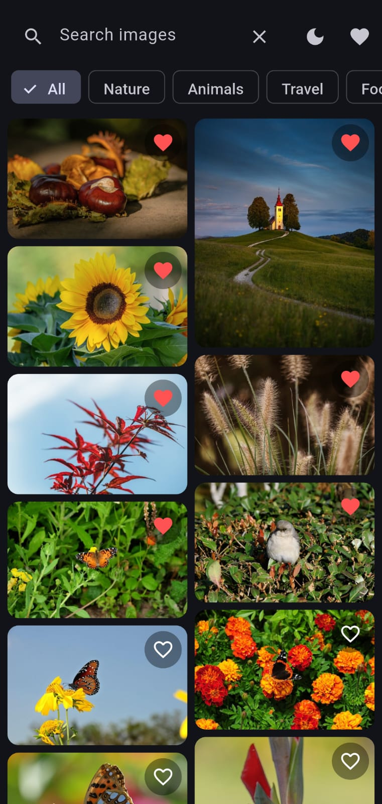

# Infinite Image Gallery (Flutter + Riverpod)

A production-style image gallery app with infinite scrolling, search, category
filters, an image detail screen, favorites and download-to-gallery. Images come
from the [Pixabay API](https://pixabay.com/api/docs/).

## Screenshots

| Home | Detail | Favorites | Dark mode |
|---|---|---|---|
|  |  |  |  |


## Features

- Responsive masonry grid (column count adapts to screen width)
- Infinite scroll with automatic pagination and an inline "Retry" on failure
- Loading, empty and error states with a retry button
- Pull-to-refresh, search and category filters
- Detail screen with hero animation, description, tags, stats, share
- Download to the phone gallery with a progress bar and permission handling
- Favorites saved locally (persist across app restarts) with a Favorites screen
- Light, dark and system themes
- Unit and widget tests

## Setup

Requirements: Flutter 3.x, Android SDK, a device or emulator.

1. Clone the repo and open the project folder.
2. Get a free API key: sign up at https://pixabay.com, then open
   https://pixabay.com/api/docs/ where your key is shown.
3. Create the key file: copy `.env.example` to `.env` in the project root and set

```
   PIXABAY_API_KEY=your_key_here
```

   `.env` is git-ignored and must exist before building because it is declared
   as an asset in `pubspec.yaml`.
4. Install dependencies and run:

```
   flutter pub get
   flutter run
```
5. Build a release APK: `flutter build apk --release`
6. Run tests: `flutter test`

If the key is missing or invalid, the app shows an error screen explaining
what to fix instead of crashing.

## Architecture

Feature-first structure with three layers per feature:

```
lib/
  core/       config, constants, errors, network (Dio), storage, theme, shared widgets
  features/
    gallery/    data (model, remote source, repository impl) -> domain (repository interface) -> presentation
    favorites/  data (SharedPreferences source) -> presentation
    download/   data (download service) -> presentation
```

Dependencies point inward: UI depends on providers, providers depend on the
repository interface, and the repository implementation depends on the data
source. The API can be swapped without touching the UI, and tests inject a fake
repository.

## State management (Riverpod)

No code generation; plain `Notifier` and `AsyncNotifier` classes.

| Provider | Type | Responsibility |
|---|---|---|
| `searchQueryProvider`, `categoryProvider` | `StateProvider` | Current search text and selected category |
| `galleryProvider` | `AsyncNotifier<GalleryState>` | Loads page 1, exposes loading/error/data, and `loadMore()` for pagination |
| `favoritesProvider` | `Notifier<List<PixabayImage>>` | Toggle favorites and persist them to SharedPreferences |
| `isFavoriteProvider(id)` | `Provider.family` with `select` | Rebuilds only the one heart icon that changed |
| `downloadProvider(image)` | `NotifierProvider.family` | Per-image download status and progress |
| `themeModeProvider` | `Notifier<ThemeMode>` | Theme choice, persisted |

Key decisions:

- `galleryProvider` watches the query and category providers, so changing a
  filter automatically rebuilds the list from page 1.
- `loadMore()` ignores calls while a load is running, removes duplicate ids,
  discards responses from a superseded query, and keeps already loaded images
  if a page fails, showing an inline retry.
- Errors are typed (`NetworkException`, `ServerException`, `PermissionException`,
  and so on) and mapped to friendly messages in one place.

## Performance

- `CachedNetworkImage` provides memory and disk caching
- Grid uses medium-size thumbnails with `memCacheWidth` to limit decoded size
- The high-resolution image loads only on the detail screen, with the cached
  thumbnail as its placeholder
- Aspect ratios are known up front, so the grid does not jump while images load

## Assumptions

- Pixabay has no description field, so the description is composed from the
  author and tags.
- Safe search is enabled and only photos are requested.
- Image attribution: all images are provided by Pixabay.

## Limitations and incomplete items

- Pixabay limits any query to 500 results, so the list ends there.
- Favorites store image metadata and URLs, not image files. Favorite
  thumbnails show offline only if they are still in the image cache.
- Storage is SharedPreferences (fine for a small list); Hive or Isar would be
  the upgrade for large collections.
- The API key is bundled in the APK through `.env`. A production app would use
  a backend proxy.
- Tested on Android only; the iOS permission entries are configured but not
  tested on a device.
- Not implemented: integration tests, localization, offline-first gallery.
